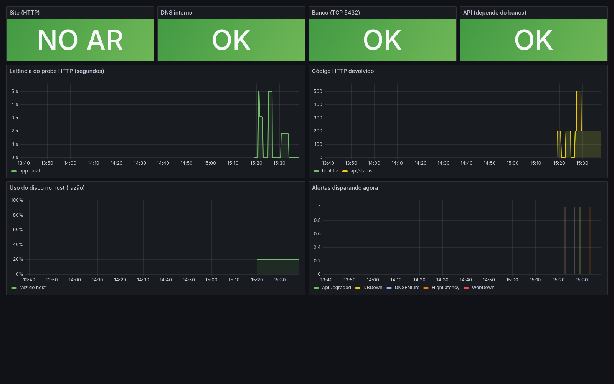
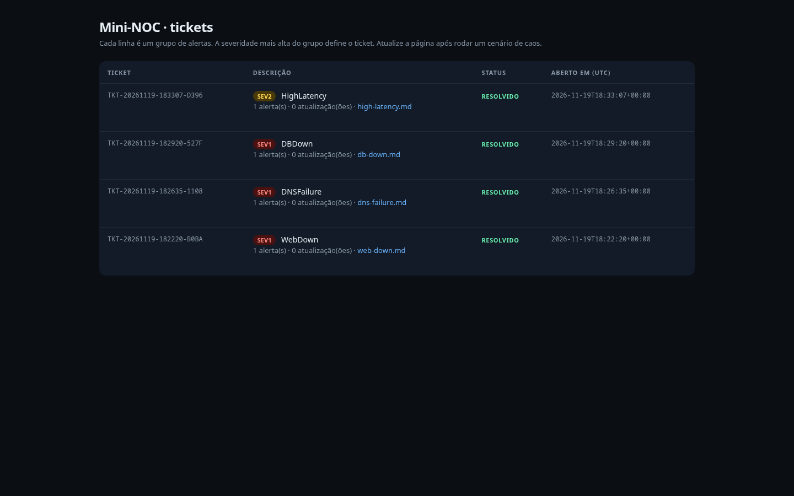
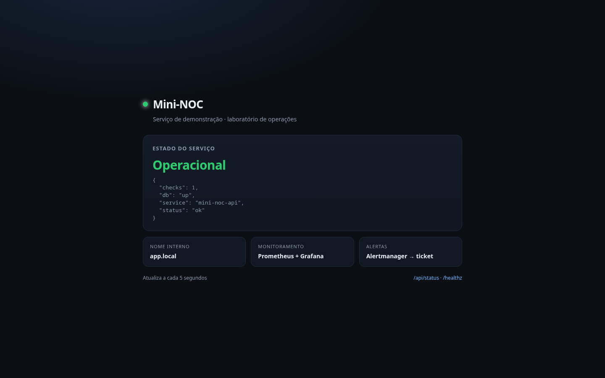
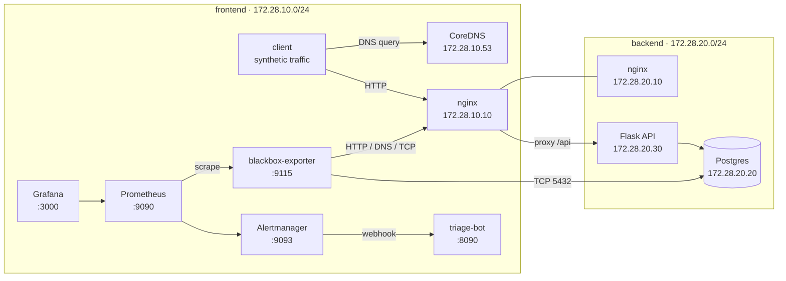

# Mini-NOC

**A small, reproducible network operations lab — monitoring, alerting, ticketing, runbooks, and measured incident response.**

[](.github/workflows/ci.yml)
[](docker-compose.yml)
[](monitoring/prometheus.yml)
[](monitoring/grafana/dashboards/mini-noc.json)
[](bot/triage_bot.py)

> *Português:* [README.pt-BR.md](README.pt-BR.md)

---

## Screenshots

| Operations dashboard (Grafana, provisioned) | Ticket queue (alert → ticket) |
| --- | --- |
|  |  |

| Demo application |
| --- |
|  |

---

## Why this exists

Most portfolio projects show that someone can *install* a tool. This one shows what happens **after** the install: an alert fires at 3 a.m., someone has to triage it, open a ticket, follow a runbook, fix it, and write down what happened.

Mini-NOC is a two-subnet service stack instrumented like a production environment. It is built to be **broken on purpose**, so the operational loop can be measured instead of claimed.

**What it demonstrates**

| Skill | Where to look |
| --- | --- |
| Linux and container networking (subnets, DNS, isolation) | [`docs/ip-plan.md`](docs/ip-plan.md), [`docker-compose.yml`](docker-compose.yml) |
| Active monitoring and synthetic probes | [`monitoring/prometheus.yml`](monitoring/prometheus.yml), [`monitoring/blackbox.yml`](monitoring/blackbox.yml) |
| Alert design: severity, `for`, grouping, inhibition | [`monitoring/alerts.yml`](monitoring/alerts.yml), [`monitoring/alertmanager.yml`](monitoring/alertmanager.yml) |
| Alert → ticket automation (Python, stdlib only) | [`bot/triage_bot.py`](bot/triage_bot.py) |
| Runbooks written for a human under pressure | [`runbooks/`](runbooks/) |
| Incident measurement and blameless postmortems | [`docs/incident-log.md`](docs/incident-log.md), [`docs/postmortems/`](docs/postmortems/) |
| Reproducibility (`make up`, smoke tests, CI) | [`Makefile`](Makefile), [`scripts/smoke-test.sh`](scripts/smoke-test.sh) |

---

## Architecture



The `client` lives only on `frontend`; the database lives only on `backend`. Docker's bridge isolation means the client **cannot** reach Postgres directly — `make isolation` proves it. `web` is the only dual-homed service, which makes it the natural "edge" of the lab.

---

## Quick start

Requirements: Docker Engine + Compose v2, Linux (developed on CachyOS/Arch), ~2 GB of free RAM. No cloud account, no paid service.

```bash
git clone https://github.com/JeipiDeveloper/mini-noc.git
cd mini-noc
cp .env.example .env        # change the passwords
make up                     # builds and starts everything
make test                   # 8-check smoke test
```

| Endpoint | URL |
| --- | --- |
| Demo application | http://localhost:8080 |
| Ticket queue (bot) | http://localhost:8090 |
| Grafana (admin / see `.env`) | http://localhost:3000 |
| Prometheus | http://localhost:9090 |
| Alertmanager | http://localhost:9093 |
| Internal DNS | `127.0.0.1:15353` (host port 5353 is mDNS) |

Then break something:

```bash
make chaos-web       # stops nginx for 120s → WebDown → ticket → resolve
make chaos-dns       # stops CoreDNS        → DNSFailure
make chaos-db        # stops Postgres       → DBDown
make chaos-latency   # adds 900ms with tc netem → HighLatency
make tickets         # inspect the ticket queue as JSON
```

Each scenario prints **INJECT / IMPACT / RECOVER** timestamps, so the detection time is auditable against the ticket timestamps.

---

## Measured incidents (not claimed — observed)

Four faults were injected on 2026-11-19. Full timeline: [`docs/incident-log.md`](docs/incident-log.md). Raw webhook evidence: [`docs/evidence/`](docs/evidence/).

| Scenario | Alert | Severity | Injected (UTC) | Ticket opened (UTC) | Time to ticket |
| --- | --- | --- | --- | --- | --- |
| nginx stopped | `WebDown` | SEV1 | 18:20:50 | 18:22:20 | **90 s** |
| CoreDNS stopped | `DNSFailure` | SEV1 | 18:24:59 | 18:26:35 | **96 s** |
| Postgres stopped | `DBDown` | SEV1 | 18:27:39 | 18:29:20 | **101 s** |
| 900 ms added latency | `HighLatency` | SEV2 | 18:30:34 | 18:33:07 | **153 s** |

**What the numbers actually mean.** Time-to-ticket is dominated by the alert's `for:` window (60 s for availability, 120 s for latency), plus one 15 s scrape and the Alertmanager `group_wait`. That is a deliberate trade-off: shortening the window detects faster but pages on single-packet blips. The reasoning is written down in [`docs/decisions/004-alert-windows.md`](docs/decisions/004-alert-windows.md) instead of being left implicit.

Two behaviours worth noticing:

- **Inhibition works.** Stopping DNS produced only `DNSFailure`; the resulting `WebDown` and `ApiDegraded` were suppressed as symptoms. Stopping Postgres produced only `DBDown`, not a second page for the API.
- **Grouping works.** When two independent critical alerts arrive inside one group window, the bot opens **one** ticket listing both, with the highest severity of the group.

---

## Alert catalog

| Alert | Condition | For | Severity | Runbook |
| --- | --- | --- | --- | --- |
| `WebDown` | `probe_success{job="blackbox-http"} == 0` | 1m | critical | [web-down](runbooks/web-down.md) |
| `ApiDegraded` | `probe_success{job="blackbox-api"} == 0` | 1m | critical | [api-degraded](runbooks/api-degraded.md) |
| `DNSFailure` | `probe_success{job="blackbox-dns"} == 0` | 1m | critical | [dns-failure](runbooks/dns-failure.md) |
| `DBDown` | `probe_success{job="blackbox-tcp"} == 0` | 1m | critical | [db-down](runbooks/db-down.md) |
| `HighLatency` | `probe_duration_seconds{job="blackbox-http"} > 0.8` | 2m | warning | [high-latency](runbooks/high-latency.md) |
| `HostDiskPressure` | root filesystem > 85% | 5m | warning | [disk-pressure](runbooks/disk-pressure.md) |

Every alert that can page has a runbook. That is the rule, not an aspiration.

---

## Repository layout

```
mini-noc/
├── docker-compose.yml        # 11 services, two isolated subnets
├── Makefile                  # up / test / chaos / tickets
├── dns/                      # CoreDNS zone for *.local
├── web/                      # nginx edge + demo page
├── api/                      # Flask API that depends on Postgres
├── db/                       # schema seed
├── monitoring/               # Prometheus, Alertmanager, blackbox, Grafana
├── bot/                      # triage-bot: alert -> grouped ticket
├── chaos/                    # fault injection, with cleanup traps
├── runbooks/                 # one per paging alert
├── docs/
│   ├── architecture.md       # components, flows, boundaries
│   ├── ip-plan.md            # addressing, ports, DNS records
│   ├── slo.md                # SLIs, SLOs, error budget, severity matrix
│   ├── incident-log.md       # measured incidents
│   ├── postmortems/          # blameless write-ups
│   ├── decisions/            # ADRs: why CoreDNS, blackbox, GitHub Issues…
│   ├── evidence/             # raw webhook payloads from the incidents
│   ├── images/               # real screenshots used in this README
│   ├── demo-script.md        # 3-minute video storyboard
│   ├── operations-report.pdf # one-page summary for applications
│   ├── interview-prep.md     # 20 questions this project prepares you for
│   ├── resume-bullets.md     # EN/PT bullets with traceable numbers
│   ├── applications/         # target list and application tracker
│   └── journal/              # build log (PT-BR)
└── scripts/smoke-test.sh     # 8 end-to-end checks
```

### Documentation map

| If you want to… | Read |
| --- | --- |
| Understand the design in 5 minutes | [`docs/architecture.md`](docs/architecture.md) |
| See the measured incidents and raw evidence | [`docs/incident-log.md`](docs/incident-log.md), [`docs/evidence/`](docs/evidence/) |
| Judge the trade-offs, not just the tools | [`docs/decisions/`](docs/decisions/) |
| See how it was operated, not just built | [`runbooks/`](runbooks/), [`docs/postmortems/`](docs/postmortems/) |
| Attach a one-page summary to an application | [`docs/operations-report.pdf`](docs/operations-report.pdf) |

---

## Design decisions (short version)

- **CoreDNS instead of Docker's embedded DNS.** The lab needs to prove name resolution as a *testable dependency*. Docker's resolver cannot be broken independently of the containers. See [ADR 001](docs/decisions/001-coredns.md).
- **Active probing (blackbox) in addition to metrics.** "Is the service up?" is not a counter in an application; it is a question you ask from the outside. Blackbox gives HTTP, DNS and TCP probes with the same tool. See [ADR 002](docs/decisions/002-active-probing.md).
- **Local tickets by default, GitHub Issues when configured.** The project must run for anyone who clones it, with no token. The GitHub integration is one function, deliberately easy to swap for ServiceNow/Jira. See [ADR 003](docs/decisions/003-ticketing.md).
- **Severity + grouping + inhibition are configuration, not code.** Alert noise is an operational design problem; it belongs in YAML where it can be reviewed. See [ADR 004](docs/decisions/004-alert-windows.md).

---

## Limitations (read this before judging it)

This is a lab, not a production NOC. Honest boundaries:

- **Single host.** No HA, no redundant power/network, no real failover. A host failure takes everything down.
- **Segmentation is Docker bridge networks, not 802.1Q VLANs.** The isolation is real, the VLAN tagging is not.
- **No dynamic routing.** There is no BGP/OSPF here; the edge is a dual-homed container. Adding FRR or containerlab is the next step, not a claim.
- **Tickets are local JSON + GitHub Issues**, not ServiceNow. The interface is intentionally one function (`_create_issue`) so the swap is small.
- **No TLS/SSO.** Grafana and Prometheus are plain HTTP on localhost.
- **Metrics retention is 15 days**, no long-term storage.

## Roadmap

1. `containerlab` + FRR: two routers, eBGP with two "ISPs", real failover measurement.
2. Swap the ticket backend for ServiceNow PDI (same webhook contract).
3. Terraform: reproduce the host + DNS + alert routing on a small VPS.
4. SLO burn-rate alerts instead of static thresholds.

---

## Reproducing the measurements

```bash
make up
make test
make chaos-web       # watch http://localhost:8090 and http://localhost:3000
make tickets         # compare opened_at with the INJECT timestamp printed by the script
```

The ticket queue is the source of truth: `opened_at` comes from the Alertmanager webhook, not from a hand-written note.

---

## License

MIT — see [LICENSE](LICENSE).
